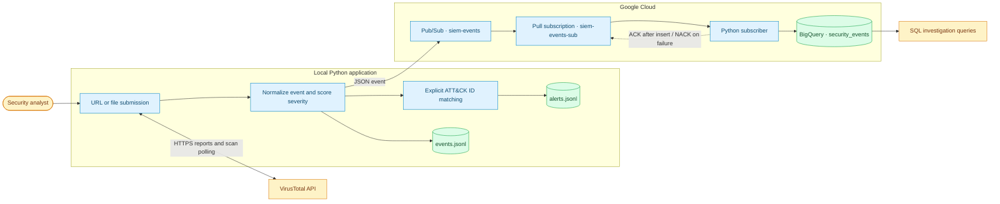

# Cloud Native SIEM

A Python security analysis lab that enriches URLs and files with VirusTotal, generates normalized security events, and streams them through Google Cloud Pub/Sub into BigQuery.

## Architecture



The CLI saves events locally before attempting cloud publication. Local alerts are saved separately; the cloud pipeline carries normalized events. The subscriber acknowledges a message only after BigQuery reports a successful insert. The subscriber is a manually run Python process; this repository does not deploy a managed cloud service.

## Features

- URL report lookup, with scan submission and polling when a report is missing.
- File upload, SHA-256 hashing, and scan result retrieval.
- Severity scoring, verdicts, and local event filtering.
- Phishing alerts when explicit `T1566` or `T1566.002` tags are present.
- Pub/Sub publication, BigQuery ingestion, and example investigation SQL.

## Run locally

Use Python 3.10 or newer. From the repository directory on Windows PowerShell:

```powershell
python -m venv .venv
.\.venv\Scripts\Activate.ps1
python -m pip install -r requirements.txt
Copy-Item config.example.yaml config.yaml
# Edit config.yaml and set your VirusTotal API key.
python main.py
```

`config.yaml`, virtual environments, local event logs, and Word documents are excluded from version control. File analysis uploads the selected file to VirusTotal; submit only material you are authorized to share with that service.

## Connect Google Cloud

Install the Google Cloud CLI and BigQuery CLI, choose a project with billing enabled, and authenticate your local application. These commands create billable cloud resources when used; they are setup instructions, not an automatic deployment.

```powershell
$env:GOOGLE_CLOUD_PROJECT = "your-project-id"
gcloud auth application-default login
gcloud config set project $env:GOOGLE_CLOUD_PROJECT
gcloud services enable pubsub.googleapis.com bigquery.googleapis.com
gcloud pubsub topics create siem-events
gcloud pubsub subscriptions create siem-events-sub --topic=siem-events
bq --project_id=$env:GOOGLE_CLOUD_PROJECT mk --dataset siem_data
bq --project_id=$env:GOOGLE_CLOUD_PROJECT mk --table siem_data.security_events schema.json
```

The publishing identity needs topic publish permission. The subscriber identity needs subscription consume permission and BigQuery table insert permission. Resource creation additionally requires the corresponding administrative permissions.

Run `python subscriber.py` in a second terminal with the same project environment variable. Then use `python main.py` to submit indicators. Optional variables are `PUBSUB_TOPIC_ID`, `PUBSUB_SUBSCRIPTION_ID`, `BQ_DATASET`, and `BQ_TABLE`. Defaults match the resource names above. Replace the project ID in `mitre_queries.sql` before running its queries.

## Detection logic and limits

| Signal | Severity |
| --- | --- |
| More than five malicious engine verdicts | CRITICAL |
| One to five malicious engine verdicts | HIGH |
| Suspicious verdicts without malicious verdicts | MEDIUM |
| No malicious or suspicious verdicts | LOW |

These are lab heuristics, not a guarantee of safety. VirusTotal tags are not a dependable ATT&CK mapping source: only tags already formatted as technique IDs are retained, so many events have no techniques or phishing alert. Scan polling is bounded, and API rate limits can interrupt analysis.

Pub/Sub redelivery can produce duplicate BigQuery rows; `event_id` can be used during investigation to deduplicate. Failed publication leaves a local event but has no automatic replay. There is no dashboard, authentication layer, infrastructure-as-code deployment, or production monitoring included.

## Repository guide

| File | Purpose |
| --- | --- |
| `main.py` | Interactive analysis, normalization, detection, local storage |
| `publisher.py` | Publish JSON events to Pub/Sub |
| `subscriber.py` | Consume events and insert into BigQuery |
| `schema.json` | BigQuery event schema |
| `mitre_queries.sql` | ATT&CK-oriented investigation examples |
| `config.example.yaml` | Safe local configuration template |

Run offline checks with `python -m unittest discover -s tests -v`. These checks do not contact VirusTotal or Google Cloud.
