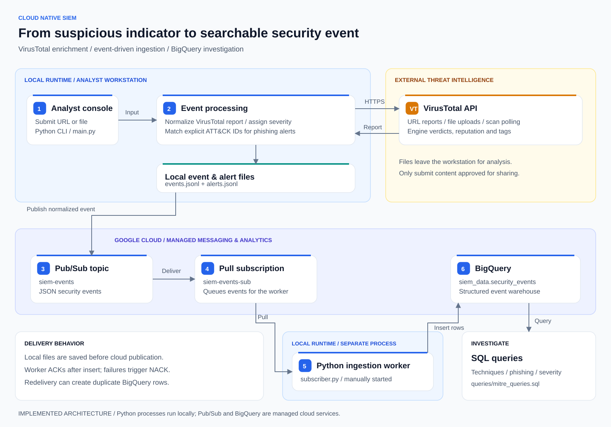

# Cloud Native SIEM

### Threat intelligence enrichment and security event analytics on Google Cloud

Cloud Native SIEM is a Python security engineering project that turns a URL or file submitted by an analyst into a structured security event. It uses VirusTotal to gather threat intelligence, assigns a verdict and severity, saves the result locally, and sends the event through Google Cloud Pub/Sub to BigQuery for investigation.

The project demonstrates a focused SIEM workflow: **collect an indicator, enrich it, normalize the findings, apply a detection rule, and make the resulting event searchable.** It connects a working command-line analysis tool to a cloud messaging and analytics pipeline.

## What problem does it solve?

A threat intelligence report contains useful findings, but investigating many reports individually makes it difficult to compare indicators or track activity over time. This project converts those findings into a consistent event schema so an analyst can review verdicts locally and query accumulated results in one place.

For example, an analyst can submit a suspicious URL, review the VirusTotal engine verdicts, and produce a `HIGH` severity event if one to five engines flag it as malicious. The event is saved locally and published to Pub/Sub. A separate Python worker consumes the message and inserts the event into BigQuery, where SQL can investigate severity, observed technique IDs, and activity over time.

## Architecture



[Open the full-size diagram](docs/architecture/architecture.svg) | [PNG version](docs/architecture/architecture.png) | [Download the editable draw.io source](docs/architecture/architecture.drawio)

To edit the diagram, open the `.drawio` file in diagrams.net or the draw.io desktop application. The source contains editable shapes, text, and connectors.

### How an indicator moves through the system

1. **Submit an indicator.** The analyst enters a URL or file path in the Python console. File submissions are uploaded to VirusTotal; URL analysis first checks for an existing report.
2. **Enrich and normalize.** The application retrieves the report and produces a common event with a unique ID, UTC timestamp, indicator, engine verdict counts, reputation, final verdict, and severity. File events also include the SHA-256 hash and filename.
3. **Save results and evaluate the rule.** Every event is appended to `events.jsonl`. Explicit phishing technique IDs (`T1566` or `T1566.002`) generate a separate local alert in `alerts.jsonl`.
4. **Publish the event.** The publisher sends the normalized JSON event to the `siem-events` topic. Pub/Sub makes it available through the `siem-events-sub` pull subscription.
5. **Ingest into BigQuery.** A separately started Python worker pulls messages and inserts events into `siem_data.security_events`. It acknowledges successful inserts and negatively acknowledges failures so messages can be redelivered.
6. **Investigate with SQL.** The included queries explore observed ATT&CK IDs, phishing-related events, activity timelines, and high-severity technique activity. Analysts can also filter saved events directly in the console.

**Deployment boundary:** the analyst console and ingestion worker run as local Python processes. Pub/Sub and BigQuery are managed Google Cloud services. VirusTotal is an external API. Alerts remain local; the cloud pipeline carries security events.

## What this project demonstrates

| Area | Implementation |
| --- | --- |
| Threat intelligence integration | VirusTotal URL lookups, file uploads, scan polling, and SHA-256 hashing |
| Security event engineering | Shared schema, UTC timestamps, unique event IDs, verdicts, and severity scoring |
| Detection logic | Local phishing alerts based on explicit ATT&CK technique IDs |
| Event-driven architecture | Pub/Sub separates event publication from downstream ingestion |
| Cloud analytics | Structured BigQuery storage and SQL investigation examples |
| Failure handling | Local save before publication; acknowledgement after successful cloud insertion |

## Run locally

Use Python 3.10 or newer. From the repository directory on Windows PowerShell:

```powershell
python -m venv .venv
.\.venv\Scripts\Activate.ps1
python -m pip install -r requirements.txt
Copy-Item config/config.example.yaml config.yaml
# Edit config.yaml and set your VirusTotal API key.
python main.py
```

`config.yaml`, virtual environments, local event logs, and Word documents are excluded from version control. File analysis uploads the selected file to VirusTotal; submit only material you are authorized to share with that service.

## Connect Google Cloud

Install the Google Cloud CLI and BigQuery CLI, choose a project with billing enabled, and authenticate your local application. These commands create billable cloud resources when used; they are setup instructions, not an automatic deployment.

```powershell
$env:GOOGLE_CLOUD_PROJECT = "your-project-id"
gcloud auth application-default login
gcloud config set project $env:GOOGLE_CLOUD_PROJECT
gcloud services enable pubsub.googleapis.com bigquery.googleapis.com
gcloud pubsub topics create siem-events
gcloud pubsub subscriptions create siem-events-sub --topic=siem-events
bq --project_id=$env:GOOGLE_CLOUD_PROJECT mk --dataset siem_data
bq --project_id=$env:GOOGLE_CLOUD_PROJECT mk --table siem_data.security_events schemas/schema.json
```

The publishing identity needs topic publish permission. The subscriber identity needs subscription consume permission and BigQuery table insert permission. Resource creation additionally requires the corresponding administrative permissions.

Run `python subscriber.py` in a second terminal with the same project environment variable. Then use `python main.py` to submit indicators. Optional variables are `PUBSUB_TOPIC_ID`, `PUBSUB_SUBSCRIPTION_ID`, `BQ_DATASET`, and `BQ_TABLE`. Defaults match the resource names above. Replace the project ID in `queries/mitre_queries.sql` before running its queries.

## Detection logic and current scope

| Signal | Severity |
| --- | --- |
| More than five malicious engine verdicts | CRITICAL |
| One to five malicious engine verdicts | HIGH |
| Suspicious verdicts without malicious verdicts | MEDIUM |
| No malicious or suspicious verdicts | LOW |

This is a portfolio lab implementing a specific indicator-analysis and ingestion workflow. The severity rules are lab heuristics, not a guarantee of safety. VirusTotal tags are not a dependable ATT&CK mapping source: only tags already formatted as technique IDs are retained, so many events have no techniques or phishing alert. Scan polling is bounded, and API rate limits can interrupt analysis.

Pub/Sub redelivery can produce duplicate BigQuery rows; `event_id` can be used during investigation to deduplicate. Failed publication leaves a local event but has no automatic replay. There is no dashboard, authentication layer, infrastructure-as-code deployment, or production monitoring included.

## Repository guide

```text
cloud-native-siem/
|-- siem/                  # Application code
|   |-- cli.py             # Menu and analysis workflow
|   |-- events.py          # Normalization and detection rules
|   |-- virustotal.py      # VirusTotal integration
|   |-- storage.py         # Local event and alert persistence
|   |-- publisher.py       # Pub/Sub publisher
|   `-- subscriber.py      # BigQuery ingestion worker
|-- docs/architecture/     # SVG diagram and editable draw.io source
|-- config/                # Safe configuration template
|-- schemas/               # BigQuery table definition
|-- queries/               # Investigation SQL
|-- tests/                 # Offline regression checks
|-- main.py                # Start the console
|-- subscriber.py          # Start the ingestion worker
|-- requirements.txt
`-- README.md
```

Run commands from the repository root. Your private `config.yaml` and generated JSONL logs stay local. Personal Word documents (`.doc`, `.docx`, and `.dox`) are excluded from GitHub.

Run offline checks with `python -m unittest discover -s tests -v`. These checks do not contact VirusTotal or Google Cloud.
